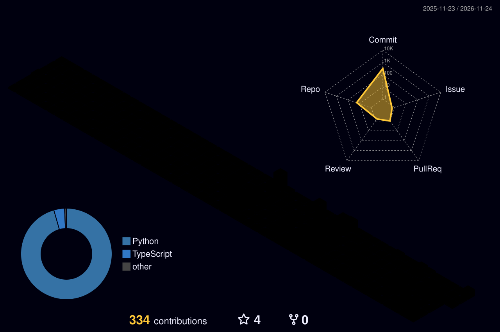

  

  
  
  
  

---

### 🧭 About me

I work on **embodied AI**: getting robots to see, reason about and act in the physical world. I like research that ends in something you can run. Most of what I do sits between models and machines: training policies, calibrating real arms, reconstructing scenes in 3D, and building the tools that make this work less painful.

I also build small, sharp developer tools, especially around AI coding agents. When a workflow annoys me twice, I write the tool.

### 🔬 Research interests

| | Area | Focus |
|:-:|---|---|
| 🤖 | **Embodied AI** | vision-language-action (VLA) models, robot manipulation, Real2Sim |
| 🕸️ | **Scene graph generation** | structured understanding of objects and their relations |
| 🧊 | **3D reconstruction and SLAM** | feed-forward 3D geometric foundation models |
| 🛠️ | **AI coding agents** | making agents such as Claude Code more useful in real workflows |

### 🧰 What I work with

  

  
  
  

### 📊 GitHub activity

  
  

  

  

<picture>
  <source media="(prefers-color-scheme: dark)" srcset="https://raw.githubusercontent.com/jzx05/jzx05/output/github-contribution-grid-snake-dark.svg">
  <source media="(prefers-color-scheme: light)" srcset="https://raw.githubusercontent.com/jzx05/jzx05/output/github-contribution-grid-snake.svg">
  
</picture>

### 📫 Get in touch

Open to research collaboration and interesting projects. The best way to reach me is by email: **jzx005xyz@163.com**

